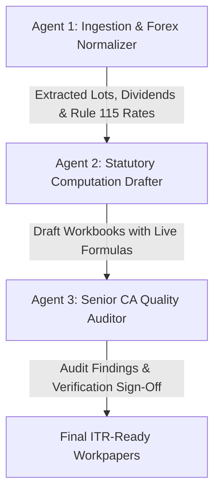

# Foreign Assets, Form 67 & RSU Capital Gains Skill

This skill acts as an automated, multi-agent Chartered Accountancy workstation designed for Indian Income Tax Return (ITR-2 / ITR-3) filings. It processes foreign employer share plans (RSUs, ESPP, Stock Options), foreign dividends, double taxation relief under Section 90 (Form 67), and foreign asset declarations under Schedule FA (Table A3).

---

## 1. Skill Activation & Command Reference

You can activate this skill instantly in any client folder using a simple skill command instead of typing a long prompt.

### Activation Commands:
- **Default Execution**:
  ```text
  /foreign-assets
  ```
  *(Alias: `/foreign-assets-itr-reporting`)*

- **With Custom Parameters**:
  ```text
  /foreign-assets --fy 2025-26 --period FINANCIAL_YEAR
  /foreign-assets --fy 2024-25 --period CALENDAR_YEAR --currency USD
  ```

- **Natural Language Trigger**:
  Simply type: `"Run foreign assets skill for this client"` or `"Process Schedule FA, Form 67 and RSU gains"`.

### What the Agent Does Automatically Upon Receiving the Command:
1. Scans the active client folder for broker statements (Fidelity, Morgan Stanley, etc.), Form 1042-S, and SBI TT rates.
2. Deploys the 3-Agent Collaborative Pipeline (Ingestion -> Computation -> Senior CA Audit).
3. Directly executes all computations and populates `Form-67.xlsx`, `RSU Gain.xlsx`, and `Schedule FA.xlsx` preserving live Excel formulas.
4. Runs automated cross-schedule reconciliations and generates an ICAI-compliant audit report without waiting for approval.

### Files Required in the Client Folder:
1. **Broker Statement / Equity Plan Summary**: PDF or Excel showing vesting tranches, vest FMVs, and stock sales.
2. **Form 1042-S / Foreign Tax Statement**: Reporting gross US dividends and federal tax withheld.
3. **SBI TT Rates CSV**: `SBI_REFERENCE_RATES_USD.csv` (or `SBI_REFERENCE_RATES_USD (1).csv`).
4. **Prescribed Excel Templates**:
   - `Form-67.xlsx` (or `Form-67_template.xlsx`)
   - `RSU Gain.xlsx` (or `RSU-CG-Calculations_template.xlsx`)
   - `Schedule FA.xlsx` (or `Schedule_FA_template.xlsx`)

---

## 2. Configurable Input Parameters

Modify any parameter below by simply mentioning it in your prompt. The agent will adapt the computations automatically:

| Parameter | Default Value | Description / Options |
|---|---|---|
| `FINANCIAL_YEAR` | `2025-26` | Indian Financial Year of the return (e.g., `2024-25`, `2025-26`, `2026-27`). |
| `ASSESSMENT_YEAR` | `2026-27` | Corresponding Assessment Year (`AY = FY + 1 year`). |
| `SCHEDULE_FA_PERIOD` | `FINANCIAL_YEAR` | **Toggle**: Set to `FINANCIAL_YEAR` (01-Apr to 31-Mar) for fiscal year-end valuation, or `CALENDAR_YEAR` (01-Jan to 31-Dec) for foreign company accounting period. |
| `FOREIGN_CURRENCY` | `USD` | Asset currency (e.g., `USD`, `EUR`, `GBP`, `CAD`, `AUD`). |
| `FOREX_RATES_FILE` | `SBI_REFERENCE_RATES_USD.csv` | File containing historical SBI TT Buying and Selling Rates. |
| `INDIAN_TAX_SLAB_RATE` | `31.2%` (0.312) | Client's effective marginal tax rate (e.g., `31.2%` for New Tax Regime 30% slab + 4% cess; or `34.32%` / `39%` if surcharge applies). |
| `DTAA_WITHHOLDING_RATE`| `25%` (0.25) | Treaty withholding tax rate under Article 10 (Dividends) of the India-USA DTAA. |
| `PRESERVE_FORMULAS` | `True` | **Strict requirement**: Retain live Excel formulas (`=ROUND()`, `=MIN()`, `=SUM()`) in all exported sheets. |

---

## 3. Statutory & Legal Guardrails

Every computation strictly adheres to the provisions of the Indian Income-tax Act, 1961, and Income-tax Rules, 1962:

### A. Rule 115 Exchange Rate Compliance
- **Rule 115(1)(e) & (c)**: Income from dividends and capital gains received in foreign currency must be converted into Indian Rupees (INR) using the **SBI Telegraphic Transfer Buying Rate (TTBR)** on the **last day of the month preceding the month** in which the dividend is paid or the capital asset is transferred.
- **Acquisition Cost for Schedule FA**: Converted into INR using the SBI TTBR on the **actual date of acquisition (vesting date)**. If the bank was closed on that date, use the latest preceding available published rate.

### B. Foreign Share Capital Gains (Section 45, 48 & 2(42A))
- **Holding Period Threshold**: Foreign shares are unlisted securities in India. The threshold for Long-Term Capital Gains (LTCG) is **more than 24 months (730 days)**. Holding period $\le$ 24 months is Short-Term Capital Gains (STCG).
- **Tax Rates**:
  - **STCG**: Added to gross total income and taxed at the taxpayer's applicable income tax slab rates.
  - **LTCG**: Post Finance Act 2024 (transfers on or after 23-Jul-2024), taxed at **flat 12.5%** without indexation benefit.
- **NIL Sales**: If no shares were sold during the financial year, report 0 transfers and explain in statutory notes.

### C. Double Taxation Relief u/s 90 (Form 67)
- **Article 10 (Dividends) of India-USA DTAA**: Foreign tax withheld by the US broker (Form 1042-S) is eligible for Foreign Tax Credit (FTC) under Section 90 read with Rule 128.
- **Relief Formula**: 
  $$\text{FTC Allowed} = \min(\text{Foreign Tax Paid in INR}, \text{Indian Income Tax Payable on such Dividend in INR})$$
- Form 67 cell `E3` **must** retain the dynamic formula `=MIN(C3, D3)`.

### D. Schedule FA (Table A3 - Foreign Equity & Debt Interest)
- **Column G (Initial Value)**: Value at acquisition: $\text{Quantity} \times \text{Vest Date FMV} \times \text{Acquisition Date SBI TTBR}$.
- **Column H (Peak Value)**: Maximum holding value reached during the reporting period:
  $$\text{Peak Value} = \max(\text{Initial Value}, \text{Closing Value}, \text{Sale Consideration})$$
- **Column I (Closing Value)**: For unsold shares held on the period-end date:
  $$\text{Quantity} \times \text{Period-End Stock Price} \times \text{Period-End SBI TTBR}$$
  *(For shares sold during the period, Closing Value is set to `0.00`)*.
- **Column J (Gross Income received)**: Total foreign dividend income received during the reporting period in INR.
- **Column K (Proceeds from Sale/Redemption)**: Total gross sale consideration received upon disposal of shares during the period in INR (`0.00` if unsold).

---

## 4. Multi-Agent Collaborative Execution Framework

To guarantee mathematical precision and eliminate hallucination, this skill operates as a **3-Agent Collaborative Review Pipeline**:



### Agent 1: Data Ingestion & Forex Normalizer (`forex-data-extractor`)
- **Role**: Document parser and foreign exchange resolver.
- **Tasks**:
  1. Parse broker statements (e.g. Fidelity Custom Transaction Summary) to isolate vesting tranches, vest dates, quantities, vest FMV prices, and stock sales.
  2. Parse Form 1042-S and dividend distribution statements for dividend dates, gross amounts, and US tax withheld.
  3. Load `SBI_REFERENCE_RATES_USD.csv` via `scripts/sbi_forex_rates.py`.
  4. Resolve Rule 115 SBI TTBR for:
     - Each dividend date (preceding month-end).
     - Each sale transaction (preceding month-end).
     - Each vest date (actual date rate).
     - Period-end closing valuation date.

### Agent 2: Statutory Tax Computation Specialist (`statutory-tax-drafter`)
- **Role**: Direct tax computation drafter.
- **Tasks**:
  1. Compute RSU Capital Gains and populate `RSU Gain.xlsx` (or `RSU-CG-Calculations.xlsx`) using `scripts/compute_rsu_capital_gains.py`. Maintain live formulas for acquisition cost (`=I*J`), gross consideration (`=M*N`), net consideration (`=P-(O*N)`), and totals (`=SUM(...)`).
  2. Draft `Form-67.xlsx` using `scripts/compute_form_67.py`. Enforce `=ROUND(B3*Slab, 2)` for Indian tax and `=MIN(C3, D3)` for relief claimed.
  3. Draft `Schedule FA.xlsx` Table A3 using `scripts/populate_schedule_fa.py`. Fill Initial Value, Peak Value, Closing Value, Gross Income, and Sale Proceeds with dynamic Excel formulas.
  4. Append comprehensive ICAI-compliant statutory notes beneath every schedule.

### Agent 3: Senior CA Auditor & Quality Reviewer (`senior-ca-auditor`)
- **Role**: Independent audit partner and cross-schedule reconciler.
- **Tasks**:
  1. Execute `scripts/audit_and_reconcile_all.py` to cross-examine all generated workbooks.
  2. **Audit Check 1 (Dividend Reconciliation)**: Verify that Gross Foreign Dividend in Form 67 Cell `B3` exactly matches Schedule FA Column J Total.
  3. **Audit Check 2 (Capital Gains Reconciliation)**: Verify that Gross Sale Consideration in RSU Gain matches Schedule FA Column K Total.
  4. **Audit Check 3 (Peak Value Validation)**: Verify that Peak Value $\ge$ Initial Value and Peak Value $\ge$ Closing Value across every single holding row.
  5. **Audit Check 4 (Formula Integrity)**: Ensure no formulas were overwritten by static values.
  6. **Audit Check 5 (Rule 115 Compliance)**: Confirm exchange rate dates correspond to the last day of the preceding calendar month.
  7. Issue the **Senior CA Audit Sign-Off Certificate**.

---

## 5. Output Deliverables & Format

When this skill runs, it delivers three fully populated Excel workbooks and prints an Executive Tax Reconciliation Summary:

### 1. `Form-67.xlsx`
| Country Name | Income outside India | Tax paid outside India | Tax payable in India | Relief claimed | Taxpayer Identification No. | Heads of income | Article of DTAA | Section of relief | DTAA rate | Tax under normal provisions |
|---|---|---|---|---|---|---|---|---|---|---|
| United States of America | ₹[Gross Div] | ₹[US Tax Paid] | `=ROUND(B3*31.2%, 2)` | `=MIN(C3, D3)` | [Client TIN/PAN] | Income from Other Sources | Article 10 | Section 90 | 25% | `=D3` |

### 2. `RSU Gain.xlsx`
Contains detailed transaction rows with formulas:
- Column I: `=ROUND(G{r}*H{r}, 2)` (Cost in USD)
- Column K: `=ROUND(I{r}*J{r}, 2)` (Acquisition Cost in INR)
- Column M: `=ROUND(G{r}*L{r}, 2)` (Gross Sale Value in USD)
- Column P: `=ROUND(M{r}*N{r}, 2)` (Gross Consideration in INR)
- Column Q: `=ROUND(P{r}-(O{r}*N{r}), 2)` (Net Consideration in INR)
- Column R / S: STCG / LTCG classification based on 730 days threshold
- Total Row: `=SUM(...)` across all columns

### 3. `Schedule FA.xlsx` (Table A3)
Contains individual tranche declarations:
- Column G (Initial Value): `=ROUND(Qty * FMV * TTBR_acq, 2)`
- Column H (Peak Value): `=ROUND(Qty * Peak_Price * TTBR_peak, 2)`
- Column I (Closing Value): `=ROUND(Qty * YearEnd_Price * TTBR_end, 2)`
- Column J (Gross Income received): Reconciled with Form 67
- Column K (Proceeds from Sale): Reconciled with RSU Gain
- Row Total: `=SUM(G3:G...)`, `=SUM(H3:H...)`, `=SUM(I3:I...)`, `=SUM(J3:J...)`, `=SUM(K3:K...)`

---

## 6. Resources & Scripts Directory

The repository includes ready-to-use templates and automation scripts:

- **`resources/`**:
  - `Form-67_template.xlsx`: Prescribed structure for foreign tax credit.
  - `RSU-CG-Calculations_template.xlsx`: Prescribed structure for capital gains.
  - `Schedule_FA_template.xlsx`: Prescribed structure for Table A3 foreign assets.
  - `SBI_REFERENCE_RATES_USD.csv`: Official historical SBI TT exchange rates.
- **`scripts/`**:
  - `sbi_forex_rates.py`: Rule 115 rate engine with lookback handling.
  - `compute_rsu_capital_gains.py`: Capital gains calculator preserving Excel formulas.
  - `compute_form_67.py`: Form 67 foreign tax credit generator.
  - `populate_schedule_fa.py`: Schedule FA generator with FY/CY period toggles.
  - `audit_and_reconcile_all.py`: Senior CA verification and cross-reconciliation engine.

---

## 7. How to Customize for Future Years or Other Currencies

1. **Changing Financial Year**: In your prompt, state `Set FINANCIAL_YEAR = "2026-27"`.
2. **Changing Period Mode**: In your prompt, specify `Set SCHEDULE_FA_PERIOD = "CALENDAR_YEAR"` (to report Jan 1 to Dec 31) or `FINANCIAL_YEAR` (to report Apr 1 to Mar 31).
3. **Using EUR / GBP / Other Currencies**: Supply the relevant currency rate file (e.g. `SBI_REFERENCE_RATES_EUR.csv`) and specify `FOREIGN_CURRENCY = "EUR"`.
